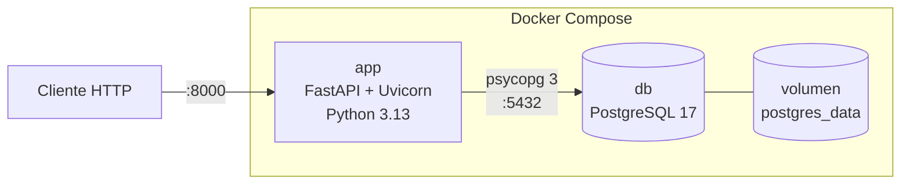

# Arquitectura

## Visión general

La aplicación son dos contenedores orquestados con Docker Compose:



| Servicio | Imagen | Puerto | Función |
|---|---|---|---|
| `app` | Construida desde `Dockerfile` (`python:3.13-slim`) | 8000 | Servidor de la API |
| `db` | `postgres:17-alpine` | 5432 | Base de datos |

## Capas de la aplicación

```
main.py     →  Punto de entrada: crea la app y registra los routers
api/        →  Capa HTTP: un router por recurso, validación de entrada/salida
models.py   →  Capa de datos: modelos SQLModel (tabla + esquemas Pydantic)
db.py       →  Acceso a datos: engine de SQLAlchemy y sesión por petición
migrations/ →  Evolución del esquema con Alembic
```

- **`main.py`** crea la app FastAPI y registra los routers con `app.include_router()`. No contiene endpoints.
- **`api/`** contiene los endpoints, un archivo por recurso. Cada uno define un `APIRouter` con su prefijo de URL y su etiqueta (`tags`), que agrupa sus endpoints en `/docs`:

  | Archivo | Prefijo | Contenido |
  |---|---|---|
  | `api/deps.py` | — | `SessionDep`: la sesión de base de datos como dependencia de FastAPI |
  | `api/health.py` | — | `GET /health` |
  | `api/articles.py` | `/articles` | CRUD de artículos |
  | `api/sections.py` | `/sections` | CRUD de secciones y `GET /sections/{id}/articles` |

  Cada endpoint recibe una `Session` mediante `SessionDep`.
- **`models.py`** define cada entidad con SQLModel. Un mismo modelo es a la vez tabla de la base de datos y esquema de validación de Pydantic.
- **`db.py`** crea el `engine` a partir de `DATABASE_URL` (con `pool_pre_ping` para descartar conexiones caídas) y expone `get_session()`, que abre una sesión por petición y la cierra al terminar.
- **`migrations/`** contiene la configuración de Alembic. `env.py` importa `models` para registrar las tablas y reutiliza el `engine` de `db.py`.

## Flujo de una petición

1. Uvicorn recibe la petición HTTP y la pasa a FastAPI, que la dirige al endpoint del router correspondiente en `api/`.
2. FastAPI valida el cuerpo con el esquema correspondiente (p. ej. `ArticleCreate`).
3. FastAPI resuelve `SessionDep` llamando a `get_session()`, que abre una sesión.
4. El endpoint lee o escribe con la sesión (`session.get`, `session.exec(select(...))`, `session.add` + `commit`).
5. FastAPI serializa la respuesta con el `response_model` (p. ej. `ArticleRead`).
6. Al terminar la petición, la sesión se cierra.

## Arranque

1. Compose arranca `db` y espera a que su healthcheck (`pg_isready`) responda.
2. Arranca `app`, que ejecuta `alembic upgrade head` para aplicar las migraciones pendientes.
3. Después lanza `uvicorn main:app` con `--reload`.

## Persistencia

Los datos de PostgreSQL se guardan en el volumen con nombre `postgres_data` y sobreviven a reinicios y a `docker compose down`. Solo se borran con `docker compose down -v`.

El código del proyecto se monta en `/app` dentro del contenedor, así que los cambios se recargan sin reconstruir la imagen (salvo si cambias dependencias o el `Dockerfile`).
