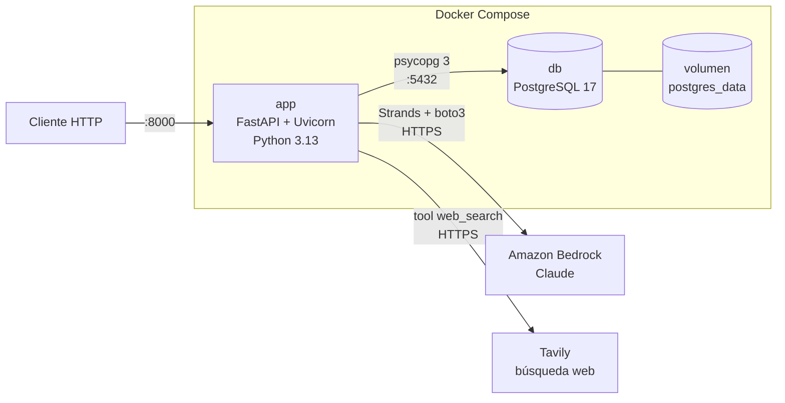

# Arquitectura

## Visión general

La aplicación son dos contenedores orquestados con Docker Compose. Para generar artículos, `app` llama a un modelo de Amazon Bedrock mediante un agente de Strands:



| Servicio | Imagen | Puerto | Función |
|---|---|---|---|
| `app` | Construida desde `Dockerfile` (`python:3.13-slim`) | 8000 | Servidor de la API |
| `db` | `postgres:17-alpine` | 5432 | Base de datos |

## Capas de la aplicación

```
main.py     →  Punto de entrada: crea la app y registra los routers
api/        →  Capa HTTP: un router por recurso, validación de entrada/salida
agents/     →  Agentes de IA (Strands): generan contenido llamando a Bedrock
agents/tools/ → Tools que los agentes pueden llamar (búsqueda web…)
models.py   →  Capa de datos: modelos SQLModel (tabla + esquemas Pydantic)
db.py       →  Acceso a datos: engine de SQLAlchemy y sesión por petición
migrations/ →  Evolución del esquema con Alembic
```

- **`main.py`** crea la app FastAPI y registra los routers con `app.include_router()`. No contiene endpoints.
- **`api/`** contiene los endpoints, un archivo por recurso. Cada uno define un `APIRouter` con su prefijo de URL y su etiqueta (`tags`), que agrupa sus endpoints en `/docs`:

  | Archivo | Prefijo | Contenido |
  |---|---|---|
  | `api/deps.py` | — | `SessionDep`: la sesión de base de datos como dependencia de FastAPI |
  | `api/health.py` | — | `GET /health` |
  | `api/articles.py` | `/articles` | CRUD de artículos y `POST /articles/generate` |
  | `api/sections.py` | `/sections` | CRUD de secciones y `GET /sections/{id}/articles` |

  Cada endpoint recibe una `Session` mediante `SessionDep`.
- **`agents/`** contiene los agentes de [Strands Agents](https://strandsagents.com/), un archivo por agente:

  | Archivo | Función pública | Contenido |
  |---|---|---|
  | `agents/writer.py` | `generate_article(topic, section_title=None)` | Agente redactor: devuelve un `GeneratedArticle` (`title`, `content` en Markdown) |

  Las tools están en `agents/tools/`, un archivo por tool:

  | Archivo | Tool | Contenido |
  |---|---|---|
  | `agents/tools/web_search.py` | `web_search(query, topic, time_range, max_results)` | Busca en internet con [Tavily](https://tavily.com/). Devuelve título, URL, fecha y un extracto de hasta 1500 caracteres por resultado (máximo 10 resultados) |

  Una tool es una función con el decorador `@tool` de Strands: el docstring y los type hints se convierten en la descripción y el esquema que ve el modelo. Si una tool lanza una excepción, Strands se la devuelve al modelo como error y el agente sigue. El agente redactor recibe `tools=[web_search]` y su prompt de sistema le pide documentarse con ella antes de escribir.

  Cada llamada crea un `Agent` nuevo (el agente guarda el historial de la conversación, así que no se comparte entre peticiones) con un `BedrockModel`. La salida se obtiene con `structured_output_model`: Strands expone el modelo Pydantic como una herramienta y valida lo que devuelve el modelo. Los agentes no tocan la base de datos: el endpoint guarda el resultado.

  Si el modelo responde sin usar esa herramienta, Strands reintenta forzándola (`tool_choice`), pero Claude Opus 5.5 rechaza el uso forzado de herramientas y la petición acaba en `502`. Por eso el prompt de sistema pide usar siempre la herramienta de salida estructurada.
- **`models.py`** define cada entidad con SQLModel. Un mismo modelo es a la vez tabla de la base de datos y esquema de validación de Pydantic.
- **`db.py`** crea el `engine` a partir de `DATABASE_URL` (con `pool_pre_ping` para descartar conexiones caídas) y expone `get_session()`, que abre una sesión por petición y la cierra al terminar.
- **`migrations/`** contiene la configuración de Alembic. `env.py` importa `models` para registrar las tablas y reutiliza el `engine` de `db.py`.

## Flujo de una petición

1. Uvicorn recibe la petición HTTP y la pasa a FastAPI, que la dirige al endpoint del router correspondiente en `api/`.
2. FastAPI valida el cuerpo con el esquema correspondiente (p. ej. `ArticleCreate`).
3. FastAPI resuelve `SessionDep` llamando a `get_session()`, que abre una sesión.
4. El endpoint lee o escribe con la sesión (`session.get`, `session.exec(select(...))`, `session.add` + `commit`).
5. FastAPI serializa la respuesta con el `response_model` (p. ej. `ArticleRead`).
6. Al terminar la petición, la sesión se cierra.

### Generación de un artículo (`POST /articles/generate`)

1. FastAPI valida el cuerpo con `ArticleGenerate` y, si hay `section_id`, el endpoint comprueba que la sección existe.
2. El endpoint llama a `generate_article()` (`agents/writer.py`), que crea el agente y llama a Bedrock (Converse API, en streaming). El modelo hace una o varias búsquedas con `web_search` (cada una es otra vuelta del bucle del agente: Bedrock → Tavily → Bedrock) y luego redacta. La petición HTTP queda abierta hasta que el modelo termina.
3. Con el `GeneratedArticle` devuelto, el endpoint crea el `Article` y lo guarda como en `POST /articles`.
4. Si falla la llamada al modelo (credenciales, permisos, región, cuota…), responde `502` y el error completo queda en los logs de `app`.

FastAPI ejecuta los endpoints síncronos en un pool de hilos, así que una generación en curso no bloquea el resto de peticiones.

## Arranque

1. Compose arranca `db` y espera a que su healthcheck (`pg_isready`) responda.
2. Arranca `app`, que ejecuta `alembic upgrade head` para aplicar las migraciones pendientes.
3. Después lanza `uvicorn main:app` con `--reload`.

## Persistencia

Los datos de PostgreSQL se guardan en el volumen con nombre `postgres_data` y sobreviven a reinicios y a `docker compose down`. Solo se borran con `docker compose down -v`.

El código del proyecto se monta en `/app` dentro del contenedor, así que los cambios se recargan sin reconstruir la imagen (salvo si cambias dependencias o el `Dockerfile`).
