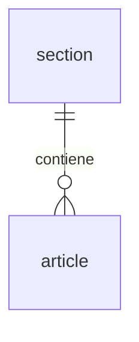

# Base de datos

## Conexión

La aplicación se conecta con la variable de entorno `DATABASE_URL`, que define `docker-compose.yml`:

```
postgresql+psycopg://<usuario>:<contraseña>@db:5432/<base_de_datos>
```

El prefijo `postgresql+psycopg` indica a SQLAlchemy que use psycopg 3. Sin él intentaría usar `psycopg2`, que no está instalado.

## Modelos

Los modelos están en `models.py`. Cada entidad sigue este patrón:

| Clase | Es tabla | Uso |
|---|---|---|
| `ArticleBase` | No | Campos comunes que comparten el resto de clases |
| `Article` | Sí | La tabla de la base de datos |
| `ArticleCreate` | No | Cuerpo de entrada de `POST /articles` |
| `ArticleGenerate` | No | Cuerpo de entrada de `POST /articles/generate`: `topic` y `section_id` opcional. No es una tabla ni cambia el esquema |
| `ArticleRead` | No | Respuesta de la API |
| `ArticleUpdate` | No | Cuerpo de `PATCH /articles/{id}`: todos los campos opcionales. `title` y `content` no admiten `null`; `section_id` sí (quita la sección) |

### Tabla `article`

| Columna | Tipo | Nulo | Notas |
|---|---|---|---|
| `id` | `UUID` | No | Clave primaria. Se genera en Python con `uuid.uuid4()` |
| `title` | `VARCHAR(255)` | No | |
| `content` | `VARCHAR` | No | Sin límite de longitud |
| `section_id` | `UUID` | Sí | Clave foránea a `section.id`, con índice. `ON DELETE SET NULL`: si se borra la sección, el artículo queda sin sección |
| `created_at` | `TIMESTAMP WITH TIME ZONE` | No | Se rellena en Python con la hora actual en UTC |

### Tabla `section`

Clases en `models.py`: `SectionBase`, `Section` (tabla), `SectionCreate`, `SectionRead` y `SectionUpdate` (cuerpo de `PATCH`: todos los campos opcionales, pero `title` no admite `null`).

| Columna | Tipo | Nulo | Notas |
|---|---|---|---|
| `id` | `UUID` | No | Clave primaria. Se genera en Python con `uuid.uuid4()` |
| `title` | `VARCHAR(255)` | No | |

### Relaciones



Una sección tiene muchos artículos y un artículo pertenece, como máximo, a una sección. En los modelos, `Section.articles` y `Article.section` son atributos `Relationship` para navegar la relación desde Python; no son columnas.

## Migraciones (Alembic)

### Archivos

| Archivo | Función |
|---|---|
| `alembic.ini` | Configuración general y logging. La URL no está aquí: se toma de `DATABASE_URL`. |
| `migrations/env.py` | Importa `models` para registrar las tablas en `SQLModel.metadata` y usa el `engine` de `db.py`. |
| `migrations/script.py.mako` | Plantilla de las nuevas migraciones. Incluye `import sqlmodel`, necesario para los tipos `AutoString`. |
| `migrations/versions/` | Una migración por archivo. |

### Historial

| Revisión | Descripción |
|---|---|
| `0001` | Crea la tabla `article` |
| `0002` | Crea la tabla `section` |
| `0003` | Añade `article.section_id` (clave foránea a `section.id`, con índice) |

### Cómo cambiar el esquema

1. Modifica o añade el modelo en `models.py`.
2. Genera la migración:
   ```bash
   docker compose exec app alembic revision --autogenerate -m "descripción"
   ```
3. **Revisa el archivo generado** en `migrations/versions/`. La autogeneración no detecta algunos cambios, como renombrar columnas o tablas (los interpreta como borrar y crear).
4. Aplícala:
   ```bash
   docker compose exec app alembic upgrade head
   ```
   También se aplica sola al reiniciar el contenedor `app`.

### Otros comandos útiles

```bash
docker compose exec app alembic current        # Revisión aplicada
docker compose exec app alembic history        # Historial de migraciones
docker compose exec app alembic downgrade -1   # Deshacer la última
docker compose exec app alembic upgrade head --sql  # Ver el SQL sin ejecutarlo
```

### Reglas

- No uses `SQLModel.metadata.create_all()`: el esquema lo gestiona solo Alembic.
- No edites una migración que ya se haya aplicado en otro entorno. Crea una nueva.

## Acceso directo a PostgreSQL

```bash
docker compose exec db psql -U postgres -d app
```

El puerto 5432 también está expuesto en el host, así que puedes conectar un cliente gráfico a `localhost:5432`.
